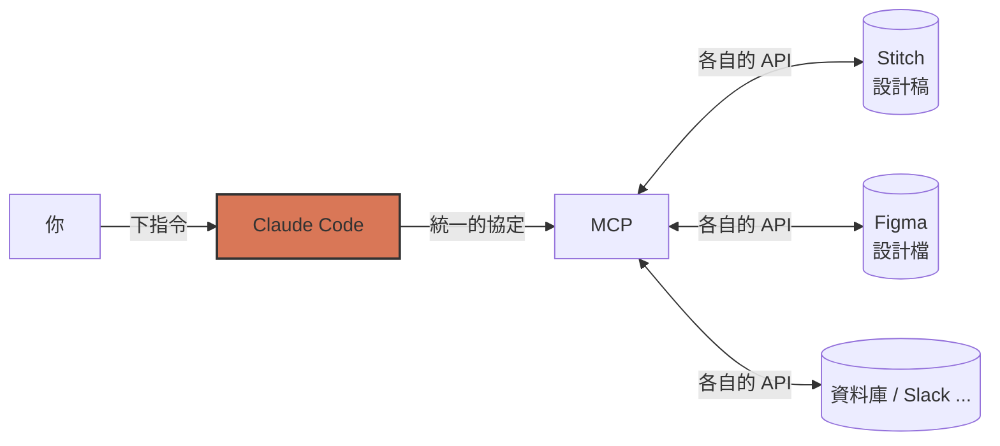

## Step 3:MCP Integration — 讓 AI 走出你的電腦(Claude Code 版)

到目前為止,Claude Code 只能看到**你這台電腦上的檔案**。設計師在 Stitch 裡畫好的設計稿,它完全看不到 —— 所以你只能自己對著畫面「目測」去調 CSS。

這一關,我們用 **MCP** 幫它接上 **Google Stitch(AI 設計工具)**,讓它直接**讀設計稿、照設計稿改樣式**。

---

### 📖 觀念:MCP 是什麼?

**MCP(Model Context Protocol)常被形容成「AI 的 USB-C」** —— 一個通用接頭。

以前每個 AI 工具要接每個服務,都得各自寫一套整合。有了 MCP,只要服務方提供一個 **MCP Server**,任何支援 MCP 的 AI 工具都能立刻用它。



三個你需要知道的名詞:

| 名詞 | 白話 |
| :--- | :--- |
| **MCP Server** | 提供能力的一方(例如 Stitch 提供的伺服器,讓 AI 能列出專案、讀取畫面的 HTML) |
| **MCP Client** | 使用能力的一方(這裡就是 Claude Code) |
| **Tools** | Server 提供的一個個具體功能(例如 `list_projects`、`get_screen`),在 Claude Code 裡名稱長得像 `mcp__stitch__get_screen` |

**Agent + MCP 是怎麼運作的?**

你每送出一則提示詞,Claude Code 會把「目前可用的工具清單」一起帶給模型。模型自己判斷:這件事需不需要用工具?用哪一個?要帶什麼參數?然後執行、拿到結果、再繼續往下做。

> 🔐 **安全提醒(請認真看)**
> MCP Server 會在你的電腦上執行程式碼、或代表你去存取遠端服務。
> - **只安裝你信任來源的 MCP Server**(官方出品、或你看過原始碼的)
> - 第一次呼叫某個工具時,Claude Code 會跳出**授權選單** —— 請**看清楚它要做什麼**再選 Yes
> - 涉及寫入的操作(建立專案、產生畫面、刪除檔案)尤其要看
> - **絕對不要把 API 金鑰直接寫進會 commit 的檔案**(下面會示範用環境變數)

---

### 📖 這一關的兩條路線

Stitch 是**線上服務**,需要網路與 API 金鑰。為了讓每個人都能走完,這一關提供兩條路線,**做出來的結果與完成檢查完全相同**:

| | 路線 A:接 Stitch MCP(推薦) | 路線 B:離線備案 |
| :--- | :--- | :--- |
| 需要網路 / 金鑰 | ✅ 需要 | ❌ 不需要 |
| 設計稿來源 | 透過 MCP 即時讀 Stitch 專案 | 讀 repo 內的 `design/stitch-sample.html` |
| 學到 MCP | ✅ 完整體驗 | 只體驗「照設計稿改樣式」,MCP 設定仍照做 |

> 💡 無論走哪條路,**你的待辦清單 App 最終都是離線可執行的** —— 設計稿只拿來當「參考」(色票、圓角、間距),不會把外部網址、CDN、網路字型帶進 `styles.css`。

---

### ⌨️ 動手做 A:接上 Stitch MCP

#### 1. 取得 Stitch API 金鑰

1. 開啟 [Stitch](https://stitch.withgoogle.com/),用 Google 帳號登入
2. 隨意用一句話產生一個「待辦清單」畫面(這就是你的**設計稿**)
3. 到 Stitch 的**設定(Settings)→ API Key**,建立金鑰並複製(介面名稱可能略有不同)

把金鑰放進**環境變數**,**不要寫進任何檔案**:

```bash
export STITCH_API_KEY="貼上你的金鑰"
```

> 💡 想長期使用可以把這行寫進 `~/.zshrc`(或 `~/.bashrc`),但**不要放在 repo 裡**。
> 🤷 沒有 Google 帳號或沒辦法連線?直接跳到「**路線 B:離線備案**」。

#### 2. 加入 Stitch server

在**終端機**(不是在 Claude Code 對話裡)、repo 根目錄執行。**注意外層用單引號**,這樣 `${STITCH_API_KEY}` 會原封不動寫進設定檔,而不是被 shell 展開成真正的金鑰:

```bash
claude mcp add stitch --transport http https://stitch.googleapis.com/mcp --header "X-Goog-Api-Key: api-key" -s user
```

參數說明:

| 參數 | 意思 |
| :--- | :--- |
| `--transport http` | 這是遠端 HTTP 型的 MCP Server |
| `stitch` | 你幫這個 server 取的名字 |
| `--header` | 認證用的 HTTP 標頭,值寫成 `${STITCH_API_KEY}`,**啟動時才從環境變數讀入** |

執行後,專案根目錄會出現 **`.mcp.json`**:

📄 **`.mcp.json`**

```json
{
  "mcpServers": {
    "stitch": {
      "type": "http",
      "url": "https://stitch.googleapis.com/mcp",
      "headers": {
        "X-Goog-Api-Key": "${STITCH_API_KEY}"
      }
    }
  }
}
```

> ⚠️ **請打開 `.mcp.json` 檢查**:`X-Goog-Api-Key` 那行必須是 `${STITCH_API_KEY}` 這種**變數寫法**,而不是真正的金鑰。不是的話,手動改回變數寫法。這樣這個檔案才**可以安全 commit**。

> 💡 **偷懶做法**:不想用指令,也可以直接自己建立 `.mcp.json` 貼上上面內容,或叫 agent 幫你建:
> ```prompt
> 請在專案根目錄建立 .mcp.json,內容如下(原封不動,不要改動任何欄位,也不要把變數展開成真實的值):
> { "mcpServers": { "stitch": { "type": "http", "url": "https://stitch.googleapis.com/mcp", "headers": { "X-Goog-Api-Key": "${STITCH_API_KEY}" } } } }
> ```

#### 3. 啟動 Claude Code 並核准

**要在已經 `export STITCH_API_KEY` 的同一個終端機**執行:

```bash
claude
```

因為 `.mcp.json` 是專案層級(別人也能放進你的 repo),Claude Code 第一次會問你**是否信任並啟用這個 server** → 看清楚名稱與網址後選 **Use this and all future MCP servers in this project** 或單獨啟用 `stitch`。

#### 4. 確認工具已載入

在 Claude Code 裡輸入:

```
/mcp
```

你應該會看到 `stitch` 狀態為 **connected**。選進去可以看到它提供的工具(例如列出專案、列出畫面、取得畫面 HTML)。

> 🤷 **看到 failed / needs authentication?** 在 `/mcp` 選單選該 server 看錯誤訊息;用 `echo $STITCH_API_KEY` 確認金鑰有值;或在終端機執行 `claude mcp list` 查看所有 server 的健康狀態。

#### 5. 讓 agent 讀設計稿(先不要改)

> ```prompt
> 請使用 Stitch 的工具,列出我的專案與畫面,找到「待辦清單」那個設計稿。
> 取得該畫面的內容後,用繁體中文整理成「設計規格」:
> 1. 亮色與深色的色票(背景、卡片、文字、主色、邊框、危險色)
> 2. 圓角、內距、陰影
> 3. 字型與字重
> 接著對照我們專案的 styles.css,條列「哪些 :root 變數需要調整」。
> 先不要動手改任何檔案,只要告訴我。
> ```

<details>
<summary>🇬🇧 English version(點開)</summary>

```prompt
Use the Stitch tools to list my projects and screens, and find the to-do list design.
Fetch that screen and summarize it as a design spec in Traditional Chinese:
1. Light and dark color palettes (background, card, text, primary, border, danger)
2. Border radius, padding, shadow
3. Font family and weights
Then compare it with our styles.css and list which :root variables need to change.
Do not modify any files yet — just report back.
```

</details>

**觀察重點** 👀:
- 終端機裡會出現 **`stitch - list_projects (MCP)`**、**`stitch - get_screen (MCP)`** 之類的工具呼叫區塊(<kbd>Ctrl</kbd>+<kbd>O</kbd> 可展開詳細輸出)
- 第一次可能跳出授權選單 → 看一眼 → **Yes**
- 回覆裡應該會有**具體的色碼與數值**,而且是來自你的設計稿

> ✨ **這就是 MCP 的價值**:設計稿不在你的硬碟裡,但 AI 可以**現場去讀它**,不用你截圖、不用你手動抄色碼。

---

### ⌨️ 動手做 B:照設計稿改樣式 🎨

不管你走路線 A 或路線 B,這一步都一樣。差別只在「設計稿從哪來」:

- **路線 A**:設計稿來自剛剛的 Stitch MCP
- **路線 B(離線備案)**:設計稿是 repo 裡的 `design/stitch-sample.html`(打開它看看,頂端註解就是設計規格)

> ```prompt
> 請依照設計稿調整 styles.css 的外觀。
> (路線 B 請改成:設計稿是 design/stitch-sample.html,請讀取它的色票與形狀規格。)
>
> 規則:
> - 只修改 styles.css,不要動 index.html 與 app.js
> - 只修改 :root 與 :root[data-theme="dark"] 的 CSS 變數,以及必要的圓角、陰影、內距
> - 顏色一律使用 CSS 變數,不要在規則裡寫死色碼
> - 不要引用外部 CDN、網路字型或設計稿裡的任何外部網址,字型維持系統字型,確保離線可用
> - 亮色與深色模式都要套用
> 動手前先條列你打算改哪些變數、新舊值對照,等我確認再開始。
> ```

<details>
<summary>🇬🇧 English version(點開)</summary>

```prompt
Restyle styles.css to match the design.
(Offline fallback: the design is design/stitch-sample.html — read its palette and shape spec.)

Rules:
- Only modify styles.css; do not touch index.html or app.js
- Only change the :root and :root[data-theme="dark"] CSS variables, plus radius/shadow/padding where needed
- Always use CSS variables; no hard-coded colors inside rules
- No external CDN, web fonts, or URLs from the design; keep system fonts so it works offline
- Apply to both light and dark mode
Before editing, list the variables you plan to change (old → new) and wait for my confirmation.
```

</details>

確認它列的清單合理後,回覆「**同意,請開始**」。

#### 驗證:用瀏覽器看結果

1. 直接雙擊打開 `index.html`(**不需要網路**,可以把 Wi-Fi 關掉試試)
2. 切換亮色 / 深色模式,確認兩種都套用了新配色
3. 把 `index.html` 與 `design/stitch-sample.html`(或 Stitch 畫面)**並排**,比對主色、圓角、卡片陰影
4. 新增、勾選、刪除一筆待辦,確認功能沒有被改壞

> ✅ 看起來像設計稿、而且功能都正常,就完成了。想還原?`git restore styles.css`。

---

### ✅ 完成檢查

- [ ] 專案根目錄有 **`.mcp.json`**,裡面有 `stitch`
- [ ] `.mcp.json` 裡**沒有**真正的金鑰(只有 `${STITCH_API_KEY}`)
- [ ] 路線 A:`/mcp` 顯示 `stitch` 為 **connected**,且成功呼叫過一次 Stitch 工具(路線 B 可略過)
- [ ] `styles.css` 已依設計稿調整,亮色 / 深色都正常
- [ ] 關掉網路後,`index.html` 仍能正常開啟與使用

---

### 🔄 出問題怎麼辦?

| 狀況 | 解法 |
| :--- | :--- |
| `.mcp.json` JSON 格式錯誤 | `git restore .mcp.json`,或刪掉後重跑 `claude mcp add` |
| 想移除某個 server | `claude mcp remove stitch`(想看細節:`claude mcp get stitch`) |
| Server 起不來、顯示 failed | `/mcp` 選該 server 看訊息;用 `claude --debug` 啟動看詳細 log |
| 401 / 403 / 授權失敗 | 確認 `echo $STITCH_API_KEY` 有值、金鑰沒被撤銷,且**在同一個終端機**啟動 `claude` |
| 改完設定沒生效 | 結束 Claude Code(`/exit`)後重新 `claude` |
| 公司網路 / Proxy 擋住連線,或沒有金鑰 | **改走路線 B**(離線備案)也可以推關 |
| 改完樣式變難看 / 功能壞了 | `git restore styles.css` 還原,再重新下提示詞 |
| AI 把外部字型或 CDN 網址寫進 CSS | 要求它移除,並重申「必須離線可用、只用系統字型」 |

> 🔸 **重要**:這一關只要 `.mcp.json` 存在就算完成。**Stitch 沒接成功也沒關係**,走路線 B 先往下走。
> (若講師的自動檢查仍是看 `.vscode/mcp.json`,請依講師指示另外放一份。)

---

### 🚀 推進到下一關

```bash
git add .mcp.json styles.css
git commit -m "step 3: 接上 Stitch MCP,依設計稿調整樣式"
git pull --rebase
git push
```

> ⚠️ commit 前再確認一次:`git diff --cached .mcp.json` 裡**看不到真正的金鑰**,只有 `${STITCH_API_KEY}`。
